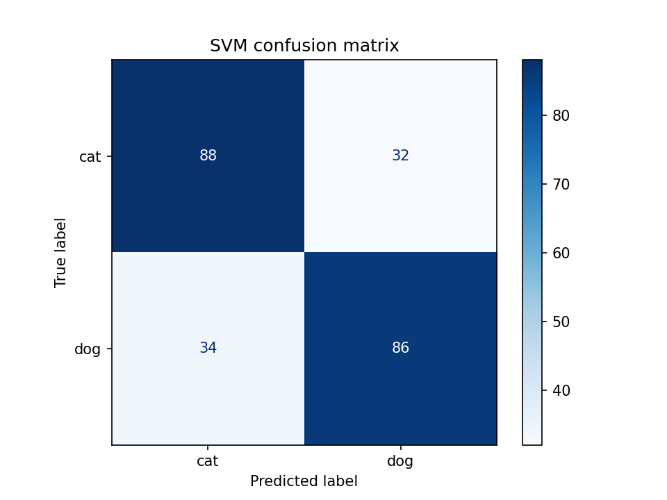
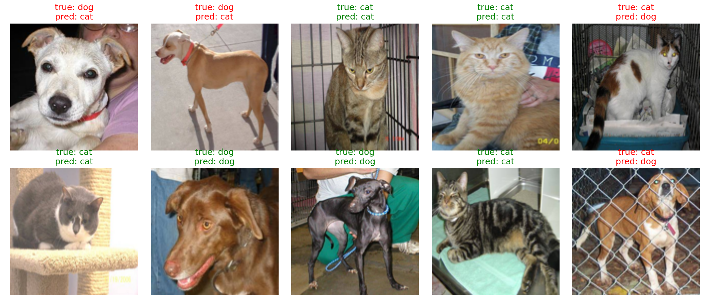

# Cats vs Dogs Classification with SVM

Classifies cat and dog images using a Support Vector Machine trained on HOG features.

## Dataset
Kaggle Dogs vs. Cats: https://www.kaggle.com/c/dogs-vs-cats
A subset of 1,200 images was used (600 cats, 600 dogs).

## Method
1. Convert images to grayscale and resize to 64x64
2. Extract HOG features (9 orientations, 8x8 cells, 2x2 blocks)
3. Standardize features, then train an RBF-kernel SVM
4. Tune C and gamma with 3-fold GridSearchCV
5. 80/20 stratified train/test split

## Results
- Test accuracy: <fill in the number from your final output>
- See confusion_matrix.png and sample_predictions.png

## Files
- `dogs-and-cats-classification.ipynb`: code and results
- `svm_cats_dogs.joblib`: trained model

## Limitations
Trained on a small subset. Classical SVMs on HOG features reach about 70-80% on
this task, while CNNs exceed 95%. Using all 25,000 images would improve accuracy.

## Run
Open the notebook on Kaggle, add the dataset as input, and run all cells.
